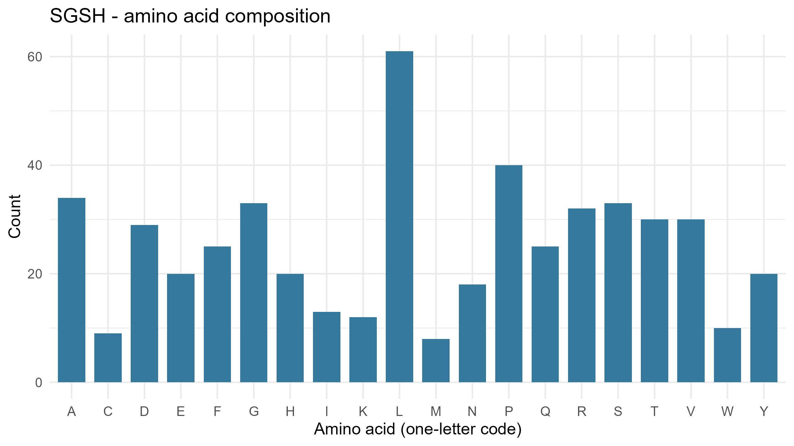
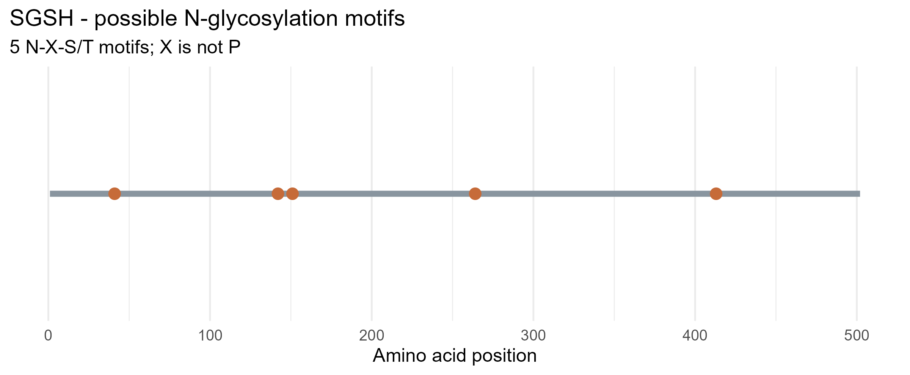

readme <- r"---(# Lysosomal Enzyme Analysis: SGSH (N-sulfoglucosamine sulfohydrolase)

- **Gene:** SGSH
- **Protein:** N-sulfoglucosamine sulfohydrolase (sulfamidase), isoform 1 precursor
- **Accession:** [NP_000190.1](https://www.ncbi.nlm.nih.gov/protein/NP_000190.1)
- **Organism:** Homo sapiens
- **Function:** SGSH is a lysosomal sulfatase that removes the sulfate group from the glucosamine sugar at the non-reducing end of heparan sulfate, so other lysosomal enzymes can finish breaking the chain down.

## Workflow

### Step 1: Select the enzyme and accession

On NCBI Protein, I searched `SGSH Homo sapiens` and selected the full-length RefSeq record NP_000190.1 (502 aa).

### Step 2: Set up the repository and project

I created the public repository `lysosomal-enzyme-SGSH` on GitHub, cloned it into RStudio as a project (File > New Project > Version Control > Git), and added `lysosomal_enzyme_analysis.R` to the project folder.

### Step 3: Set up Git

Before committing, I set my name and email in the RStudio Terminal:

```
git config --global user.name "Ferrer Mary Rose"
git config --global user.email "my GitHub email"
```

### Step 4: Edit the script

Only these two lines were changed:

```r
gene <- "SGSH"
accession <- "NP_000190.1"
```

### Step 5: Install packages and run the script

```r
install.packages(c("rentrez", "ggplot2"))
```

I confirmed `getwd()` pointed to the project folder, then ran the whole script with Source.

### Step 6: Sequence downloaded from NCBI through R

The script does not use a local file. It downloads the FASTA record directly from NCBI with rentrez:

```r
fasta <- rentrez::entrez_fetch(db = "protein", id = accession,
                               rettype = "fasta", retmode = "text")
writeLines(fasta, file.path("data", paste0(gene, ".fasta")))
```

The saved file `data/SGSH.fasta` has this header:

```
>NP_000190.1 N-sulfoglucosamine sulfohydrolase isoform 1 precursor [Homo sapiens]
```

### Step 7: Console output

```
Analysis complete for SGSH (NP_000190.1)
  gene   accession length_amino_acids potential_N_glycosylation_motifs
1 SGSH NP_000190.1                502                                5

Five most common amino acids:
 amino_acid count percent
          L    61   12.15
          P    40    7.97
          A    34    6.77
          G    33    6.57
          S    33    6.57

Files saved in data/, results/, and figures/.
```

### Step 8: Files generated by the script

| Folder | File | Content |
|---|---|---|
| data/ | SGSH.fasta | Protein sequence from NCBI |
| results/ | SGSH_summary.csv | Length and motif count |
| results/ | SGSH_amino_acid_counts.csv | Counts and percentages for the 20 amino acids |
| results/ | SGSH_motif_positions.csv | Positions and sequences of N-X-S/T motifs |
| figures/ | SGSH_amino_acid_composition.png | Figure 1 |
| figures/ | SGSH_potential_N_glycosylation.png | Figure 2 |

### Step 9: Commit and push to GitHub

In RStudio, I opened the Git tab, staged all the files, wrote the commit message "Add SGSH analysis and README", clicked Commit, and then clicked Push.

## Results

### Amino acid composition

SGSH is 502 amino acids long. Leucine is the most common residue.



*Figure 1. Count of each amino acid in SGSH (NP_000190.1).*

### Potential N-glycosylation motifs

The script searched for N-X-S/T, where X is not proline, and found 5 motifs:

| Position | Motif |
|---|---|
| 41 | NNS |
| 142 | NGS |
| 151 | NIT |
| 264 | NDT |
| 413 | NRT |



*Figure 2. Positions of the 5 potential N-glycosylation motifs along the 502-aa protein.*

## Answers to the Questions

**1. What does your enzyme normally break down inside lysosomes?**
Heparan sulfate, a glycosaminoglycan. SGSH removes the sulfate group from the N-sulfated glucosamine at the non-reducing end of the chain, which lets other lysosomal enzymes continue the breakdown.

**2. What is the total length of your protein, and which amino acids are most common?**
502 amino acids. The most common are leucine (61, 12.15%), proline (40, 7.97%), alanine (34, 6.77%), and glycine and serine (33 each, 6.57%).

**3. How many potential N-glycosylation motifs did you find? Where are they located?**
Five, at positions 41, 142, 151, 264, and 413 (see the table above).

**4. Why can glycosylation matter for lysosomal proteins? Does finding a motif prove the protein is glycosylated?**
N-glycans on lysosomal enzymes can be modified with a mannose-6-phosphate (M6P) tag. M6P receptors recognize this tag and sort the enzyme to the lysosome. Glycosylation also helps folding and stability. No. N-X-S/T only predicts a possible site. It does not show that a glycan is attached, that the site is used, or that an M6P tag is present.

**5. What could happen in the cell if your enzyme did not work properly?**
Heparan sulfate would not be fully broken down and would build up in the lysosomes, which disrupts cell function. In humans, SGSH deficiency causes mucopolysaccharidosis type IIIA (MPS IIIA, Sanfilippo syndrome A), a lysosomal storage disease that mostly affects the brain and nervous system.

## Repository Contents

```
lysosomal_enzyme_analysis.R
data/      SGSH.fasta
results/   SGSH_summary.csv, SGSH_amino_acid_counts.csv, SGSH_motif_positions.csv
figures/   SGSH_amino_acid_composition.png, SGSH_potential_N_glycosylation.png
```

**Note:** N-X-S/T is a potential N-glycosylation motif, not confirmation of a glycan or an M6P tag. Sequence analysis does not measure enzyme activity.
)---"

writeLines(readme, "README.md")
